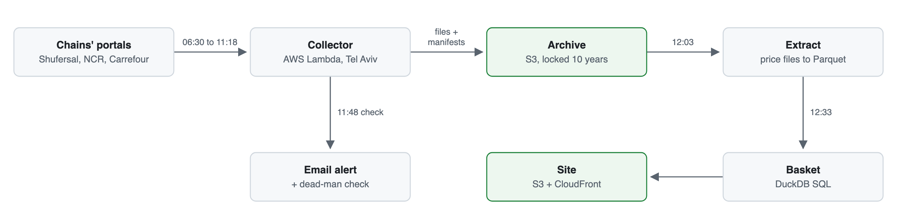

# Israeli grocery price tracker: one basket, five chains

   

Collects, every morning, the price files five Israeli supermarket chains must publish by law, keeps them in a write-once archive for ten years, and prices the same basket of 32 identical products at each chain from them.

**Live site:** [d153udx05irk2f.cloudfront.net](https://d153udx05irk2f.cloudfront.net) · **Design notes:** [docs/](docs/README.md) · **Run it yourself:** [docs/operations.md](docs/operations.md)

**Stack:** Python 3.13 · AWS SAM (Lambda, EventBridge Scheduler, S3 Object Lock, SNS, CloudWatch Logs) · DuckDB and Parquet · S3 + CloudFront for the site · healthchecks.io · GitHub Actions

Built by Doron Reiffman ([LinkedIn](https://www.linkedin.com/in/doronreiffman)).

*The live page, as of 4 November 2026.*

## At a glance

| | |
|---|---|
| Chains | 5 (Shufersal, Rami Levy, Osher Ad, Carrefour, Yochananof), on three portals |
| Every morning | 16 collection runs from 06:30 to 11:18 and a check at 11:48, then 6 basket runs at 12:03 and 12:33 (Israel time) |
| Price rows read | 5,140,268 on 2 November 2026 |
| Basket | 32 products, matched by barcode |
| Kept for | 10 years, write-once (S3 Object Lock) |
| Tests | 1,312 (99.8% coverage), plus 1,059 planted bugs, all caught |
| Cost | about $1 to $3 a month in the first year, plus about $0.10 to $0.90 for the basket (about $3.50 at worst) |

## Why

Under Israel's food-competition law, the big supermarket chains publish their prices as files on the web, one set per store for every day it is open, and anyone may use them freely. The chains' portals show only recent files; Shufersal's shows only the latest one per store and file type. The regulations make the chains keep their files for three months, not keep them online, so a price history exists only if someone collects the files every day.

This project collects them. It stores every morning's files exactly as published and turns them into one number a visitor can check: what the same basket of everyday products costs at each chain, from that morning's files.

## What it does today

- **Collector**, live on AWS since 1 November 2026. A Lambda function in Tel Aviv runs 17 times each morning, between 06:30 and 11:48 Israel time: a main run per chain (Shufersal's split by file type), a retry run three hours later that fetches only what is still missing, and a check at 11:48. The schedules are set in Israel time, so daylight saving needs no handling.
- **Archive.** Shufersal, Rami Levy, Osher Ad, Carrefour and Yochananof, on three portals. For each chain: the day's store list and every store's full price and full promotions files; for all but Shufersal, also the update files already listed that morning. Every file is stored byte for byte as published, with a manifest per run of what was listed, stored and missing, all locked for ten years under S3 Object Lock (governance mode).
- **Headline basket**, scheduled every morning since 3 November 2026. A second Lambda function turns each chain's full price files into a Parquet table at 12:03 (5,140,268 rows across the five chains on 2 November 2026), then at 12:33 prices the basket with DuckDB SQL. The basket is 32 products identified by barcode, from milk and rice to bleach and shampoo, so each one is the identical product at every chain. A chain's price for an item is the median of its stores' listed prices, before promotions.
- **Site**, live at [d153udx05irk2f.cloudfront.net](https://d153udx05irk2f.cloudfront.net). One page in English with each product's Hebrew name, a method page with the rules and the barcode list, and each day's numbers as a JSON file. The basket run rebuilds and uploads it every morning. Search engines are asked not to list it, so visitors arrive by link.

## How it works

<picture>
  <source media="(prefers-color-scheme: dark)" srcset="docs/img/flow-dark.png">
  
</picture>

All times are Israel time.

## Engineering choices worth a look

- **Nothing stored is ever replaced.** History can't be collected after the fact, so every file, manifest and check record is written once and locked for ten years. A different file arriving under a stored name is kept beside it, its name marked with part of its hash. The basket's tables are derived, so a parser fix rebuilds a day from the raw files. [docs/collector.md](docs/collector.md#storage)
- **A polite collector that stops cold.** One request at a time per chain, a half-second pause between files, and a User-Agent that names the project and a contact. A refusal (a 401, 403 or 429, a captcha, an HTML page where a file belongs) stops that chain until a person clears it, and the collector never tries a way around it. Chains whose portal needs a password or shows a captcha were left out, and so were three whose portal terms claim ownership of the price list. [docs/collector.md](docs/collector.md#chains-in-version-one)
- **Three portals, each with its own traps.** Shufersal's pager returns its last page again past the end, and its download links expire after 30 minutes. The portal Rami Levy, Osher Ad and Yochananof share sends its totals as text. One Rami Levy store publishes ZIP files under `.gz` names, in a layout of its own. A Carrefour file can carry a store number that differs from its name. Each is written down from what the portal sent, and the tests run against trimmed sample files. [docs/portals.md](docs/portals.md)
- **Alerts for missing data, not for errors.** Errors that recover by themselves stay in the logs. The 11:48 check emails when a file a chain listed is still not stored after the retry run, when a chain is stopped, or when a retry run failed. If no check reports at all, a dead-man check on healthchecks.io emails instead, and the basket run has a dead-man check of its own. [docs/operations.md](docs/operations.md#what-runs-when)
- **A number anyone can reproduce.** The barcodes and the rules are published, and the pricing rules run as DuckDB SQL, each with tests of its own. Every build writes a private record naming the basket version and a fingerprint of the code. A published day changes only with a dated reason shown on its page, the earlier figures kept beside it. [docs/headline-basket.md](docs/headline-basket.md#the-number-rules)
- **Claims no stronger than the evidence.** The page says "listed price" and "before promotions", never "cheapest chain", "you'll pay" or "at the till". A check before every upload refuses a page that uses a banned phrase or lacks the credit line. [docs/headline-basket.md](docs/headline-basket.md#words), [docs/terms.md](docs/terms.md)
- **Tests that are themselves tested.** 1,312 tests covering 99.8% of the collector's and the basket's code, and 1,059 deliberate bugs that a [script](scripts/mutation_check.py) plants one at a time to prove a test catches each (as of 5 November 2026). CI runs both on every push, along with a lint of the AWS templates. Template tests pin the settings safety depends on: the archive's lock, the functions' permissions, the schedules.
- **Cheap, boring infrastructure.** About $1 to $3 a month for the collector in its first year, about $0.10 to $0.90 more for the basket (about $3.50 at worst), and under $0.05 for the site, each estimate written down with its sources. [docs/operations.md](docs/operations.md#cost), [docs/headline-basket.md](docs/headline-basket.md#cost-monthly-estimates)

## What's next

- **A history view.** Each day's numbers are kept as a JSON file from the first day, so a view over time needs no rebuild.
- **Promotions**, read by an AI from the files' fine print ("N for ₪M", club-only deals), with a published score for how often it is right.
- **A wider index** of every product all five chains stock, once the headline basket stands.

## Data and license

Source: the price files Shufersal, Rami Levy, Osher Ad, Carrefour and Yochananof publish under section 30 of the Food and Pharma Competition Promotion Law, 2014. Section 30(ה) lets anyone access the published data and use it freely and without payment, for private or commercial purposes ([Nevo's consolidated text](https://www.nevo.co.il/law_html/law00/132302.htm)). The clause and my reading of it, which is not legal advice, are in [docs/terms.md](docs/terms.md). Every page of the site credits the chains' files, the law and the files' date. The prices shown are listed prices, not a promise of what a till charges, and not shopping advice. The raw files are never published, only numbers derived from them. This is an unofficial project, not affiliated with or endorsed by any of the chains or the State of Israel.

## Operating it

Deploying the collector and the basket function, the manual runs, clearing a stopped chain, dropping a chain, development and costs: [docs/operations.md](docs/operations.md). If a chain is stopped, see [A stopped chain](docs/operations.md#a-stopped-chain). If a basket morning fails, see [What a /fail email means](docs/operations.md#what-a-fail-email-means).

This repository was recreated on 4 November 2026 after a visibility change on GitHub's side stayed stuck; its commit history carried over unchanged.
