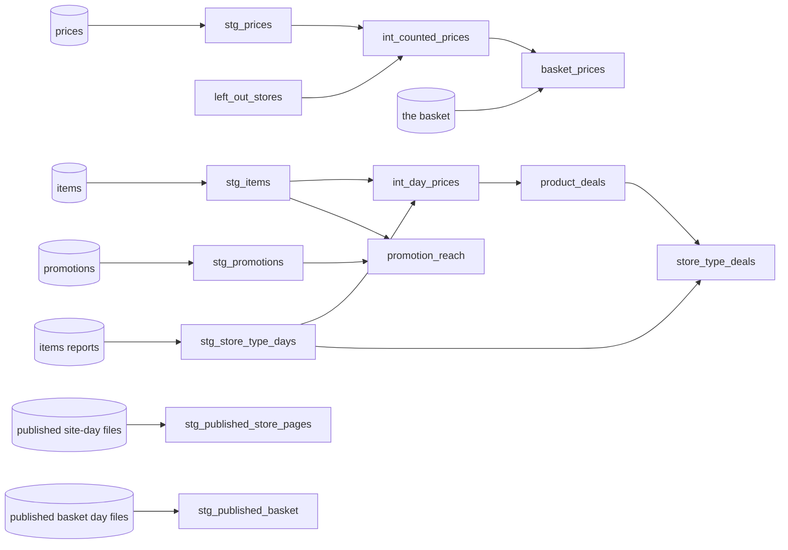

# The dbt layer: analysis models and data tests over the morning's tables (design)

**Grade:** the project's grade: a test for every component, a planted bug for every rule, a fresh review before anything ships, dependencies pinned and at least a month old, docs in plain words. Not production: nothing here feeds the live site or runs in AWS.

**Status:** approved by the owner on 2026-11-25. Nothing is built yet. Every figure was measured that day on the Mac, by read-only DuckDB queries over `data/tables/` and by a throwaway dbt project kept outside the repository. "Sources" says which. Anything not checked is marked UNVERIFIED. A choice that is not the owner's is a call, listed at the end; the owner can overturn any. The owner answered its four questions the same day (below). Revised the same day after a fact-check of every claim (17 held, 15 corrected, 1 marked UNVERIFIED) and after a probe of dbt v2 (section 6, "The version").

**Amended 2026-11-26,** after the review of the lineage map and the docs, the code taken as the source: section 9's draft names Rami Levy, Osher Ad and Yochananof for its check of the listed price against the prices table, the three chains that test runs at (section 3, "Across tables"), and says the extraction reads "XML in two layouts, each arriving as a gzip, a ZIP or plain XML", as `src/basket/pricefile.py` reads it, where it said "gzipped XML in three layouts"; section 8's line on a machine with no published files says what a run there did: the two published staging views fail, `dbt run` exits 1 and the other twelve models build.

**Amended again 2026-11-26,** after the review of the whole branch, the code taken as the source: section 3's second failing test says what the known differences do, a listed day skipped whole, so a further difference on it stays unseen while it is listed, and a test that proves only that each listed day still differs in some figure, where it said the list could hide nothing and could not go stale (`dbt/macros/published_differences.sql`, `dbt/tests/published/known_differences_still_differ.sql`); section 9's draft says "one price row per chain, store, item code and day", the key the prices test holds (`dbt/models/sources.yml`), where it said "one row per store and barcode". Section 8's install and commands are superseded by [operations.md](operations.md), "The dbt layer, on the Mac": the pinned install, `packaging` first and the 59 pins built with `--no-build-isolation`, since a plain `pip install -r requirements-dbt.txt` would fetch `packaging` unpinned for the isolated build of the parser package (`requirements-dbt.txt`'s own note); and `dbt run` then `dbt test`, never one `dbt build`, where a data test that fails as an error skips the models downstream of what it reads.

## Why

The owner asked whether dbt earns its place over plain DuckDB here. The answer given: mostly for the job market. The project has three tables, one author and one engine, and much of the extraction is Python woven through its SQL. dbt does add two things: tests that run on the real rows at every build, and a lineage map a reader can follow.

The owner's decision (2026-11-25): dbt, with the dbt-duckdb adapter, as an analysis layer on the Mac. It reads the prices, items and promotions tables the morning already writes, and builds analysis models from them, with data tests and the lineage map, at $0 a month. The extraction and the morning's Lambda runs stay Python and DuckDB, untouched. The README says plainly why.

## Goals

1. Tests on the real rows at every build, each one a rule the design notes already state.
2. Models that answer, in SQL alone, questions a reader of the site would ask.
3. Proof on real data: each model is compared with numbers the site already published.
4. A lineage map a reader of the repository sees without installing anything.
5. The project's grade for the SQL: unit tests on synthetic rows, and a planted bug for every rule.
6. $0 a month.

## Non-goals

- Lambda, the live site's pipeline, any change to the extraction.
- Airflow. A later item orchestrates on the Mac.
- Publishing a model's rows. The models stay in a local file.
- dbt's incremental models, snapshots, seeds, packages, exposures, Parquet outputs, dbt Cloud, a schedule.

## Anti-goals (a failure even if everything else works)

- A second way of building the live tables.
- A raw row, a model's row or a local path on a public page.
- A test that fails on real data and is dropped quietly, or left failing with no reason.
- A number here that disagrees with the site's and does not say so.
- dbt's packages in the environment the collector's tests run in.

## dbt's words, as used here

- **Source:** a table dbt reads and does not build. Here: Parquet and JSON files, read in place.
- **Model:** one SQL `select` in a file. dbt builds it as a view or a table in a local DuckDB file.
- **Data test:** a query that must return no rows, run on the real rows after a build.
- **Unit test:** a model run on a few rows typed into the test, with the expected rows beside them. It needs no data.
- **Lineage:** the graph of which model reads which, which dbt works out from the SQL.

## 1. What it reads

Seven sources, each read in place through dbt-duckdb's `external_location`; nothing is copied.

| Source | Files | On the Mac, 2026-11-25 |
|---|---|---|
| prices | `data/tables/prices/chain=<slug>/date=<day>/prices.parquet` | 60 files, 12 days, 58,254,923 rows |
| items | `data/tables/items/.../items.parquet` | 115 files, 23 days, 2,991,201 rows |
| promotions | `data/tables/promotions/.../promotions.parquet` | 60 files, 12 days, 792,836 rows |
| items reports | `report.json` beside each items table | 115 files, 207 store-type days |
| published site-day files | `site/site-days/<day>.json` | 14 files, 11 with store-page numbers (13 to 23 November) |
| published basket day files | `site/days/<day>.json` | 22 files |
| the basket | `src/basket/baskets/v1.json` | 32 barcodes |

The items report is a source because rule S0 needs it: whether a store type's day is a hole or a promotion hole is in the report, not in the table ([store-first.md](store-first.md), S0: "the items report's `promo_hole`"). Only its `columns` block is read: counts and flags. Its list of store numbers is never read.

Every file's column names and types are the same within each table (checked with `parquet_schema`: one layout over 60, 115 and 60 files).

## 2. The models

Fourteen models: six staging views that only rename, two small lists, two intermediate models and four analysis tables. "Store type" is the site's word for a column ([store-first.md](store-first.md), "The rules").

**Staging (views, rename only):** `stg_prices`, `stg_items`, `stg_promotions`, `stg_store_type_days` (one row per store type and day, from the reports), `stg_published_store_pages`, `stg_published_basket`.

**Two lists, written as SQL, not as seed files:**
- `left_out_stores`: the stores rule B2 leaves out by number: Shufersal's sub-chain 5 and store 413, Rami Levy's store 39, Carrefour's store 471 ([headline-basket.md](headline-basket.md), B2). A pytest holds it equal to `basket.chains.EXCLUDED`.
- `known_differences`: published store-type days that today's tables no longer give, each with its reason (section 3).

**Intermediate:**
- `int_counted_prices` (view): the price rows that count: not left out (B2, by number), above ₪0.01 (B4).
- `int_day_prices` (table): for each store type, product and day, the day price (S1): the lower of the listed price, to the agora, and the lowest promotion that counts that day (S3: `wide`, `valid`, and running that day). A day on promotion with no readable price has no day price. A day is tracked when the store type's prices and promotions were both read (S0).

**The four analysis tables**, each a question a reader of the site would ask:

1. **`product_deals`: "Is this promotion a deal, at this store type, today?"** One row per store type, product and day on which a promotion counts: today's price, the usual price (S2: the middle of the day prices over the tracked days of the 90 days before, the higher middle of an even count), the saving, the days tracked, the days on sale, whether it passes the front list's bar (20 days with records in the 30 before), and the verdict: deal at ₪1.00 or more (S4), no deal, or no verdict. Only covered products count (P1). Built from the items table and its reports. It is compared with the rows each store page shows, as the site-day files publish them.
2. **`store_type_deals`: "At each store type today, how many of the promotions are deals?"** One row per store type and day: M, the promotions checked, and N, the deals among them: the store page's headline ([store-first.md](store-first.md), "The front page's list"). Beside them, how many of the M were on sale on every tracked day, and on more than half. Compared with the published N and M.
3. **`promotion_reach`: "Is this promotion on at most branches, or at a few?"** One row per store type and day: the promotions running on listed products, those at half the branches or more (P3), those at fewer, those with a restriction, those with a minimum spend (P5). Built from the promotions table, with the items table for "listed". Its count at most branches is compared with the published promotions count.
4. **`basket_prices`: "What does each chain list for the basket's 32 products?"** One row per chain, day and basket barcode: the median across the chain's stores, one price a store (B5), the lowest and highest, and the stores listing it. Built from the prices table. Compared with the published basket day files.

One sentence each on why it is here. `product_deals` and `store_type_deals` are the site's own question, so they are the proof that the SQL is right. `promotion_reach` gives the promotions table a reader's question and a published number to match. `basket_prices` does the same for the prices table, and its one miss is the measured case for the README (section 9).

No model reads the clock: a model's day is always the table's day. No price is cast to a floating-point type (section 10).

The lineage:



## 3. Data tests on the real rows

Each test is a rule the design notes give. Each was run on 2026-11-25 as a read-only query. "Holds" means no row broke it.

**Prices** ([headline-basket.md](headline-basket.md))

| Test | Rule | Today |
|---|---|---|
| One row per chain, day, store and code | B3 | Holds: 0 repeats in 58,254,923 rows. 80 s in dbt, 108 s as a query: tagged `slow` |
| One file per store and day | B1 | Holds |
| Each row's file is a `PriceFull` file of its day | B1 | Holds: 8,063 files |
| A GS1 code has 8 to 14 digits, no leading zero, and its check digit holds, worked again in SQL; no other code passes | `basket.barcode.is_gs1` (8 to 14 digits). [headline-basket.md](headline-basket.md)'s "Identity" says 8, 12, 13 or 14, so the two disagree on 9- and 10-digit codes; the owner settles which is right before this test is written | Holds against the code: 73,385 codes pass, 0 of the 4,612 others pass at those lengths |

**Items** ([shopper-site.md](shopper-site.md), [store-first.md](store-first.md), [operations.md](operations.md))

| Test | Rule | Today |
|---|---|---|
| One row per day, store type and product | operations.md, "Where things land" | Holds |
| The store type is one of the nine, under its own chain | store-first, "The rules" | Holds |
| Lowest ≤ listed ≤ highest; listed above ₪0.01; at least one store lists it | P2, B4, B5 | Holds |
| `wide` is "at least half the store type's stores with a file list it", worked from the store count and the report | B6 per store type, P1 | Holds on all 2,991,201 rows |
| `on_promotion` is true exactly when a promotion on the row is at half the stores, has a kind and runs that day | P3, as `shopper.items` reads it | Holds |
| Each promotion on a row starts on or before it ends, has not ended before the day, and appears once | P3 | Holds: 1,362,118 entries |
| A valid deal's price is above ₪0.01 and below twice the listed price, as shown | P4 | Holds: 1,317,755 valid deals |
| A store-type day's hole and promotion hole follow its counts | B8 per store type, S0 | Holds: 207 store-type days |
| Every chain has a table on every day from the first to the last | No rule states it: a missing table is a day not extracted | Holds: 115 of 115. A warning, not an error |
| The table agrees with its report: rows, wide, on promotion, valid deals | the report is the table's own count | **Fails**: valid deals differ on 50 of 207 store-type days |

**Promotions** ([shopper-site.md](shopper-site.md), with "Changed after the survey")

| Test | Rule | Today |
|---|---|---|
| One row per day, store type, promotion, group and code | operations.md, "Where things land" | Holds |
| `wide` is "at least half the counted stores carry it"; 1 ≤ stores ≤ the promotion's stores ≤ counted | P3, survey 1 | Holds |
| No promotion ended before the day; start on or before end | P3 | Holds |
| The kind follows the reward type: 1 and 10 "N for ₪M", 2 percent off, 3 fixed price, 0 none; never 6 or 12 | P3, survey 3 | Holds |
| A minimum spend, when stated, is above zero | [shopper-site.md](shopper-site.md), "Changed after the survey" ("the largest `MinPurchaseAmount` above zero") | Holds: 23,956 rows state one |
| The stores' discounted prices are in order; the percent-off counts are in order and only on percent off | survey 5 | Holds |
| `counted` is the report's counted stores for that store type and day | P3: "the stores counted are P2's" | Holds: 104 store-type days |

**Across tables**

| Test | Rule | Today |
|---|---|---|
| At Rami Levy, Osher Ad and Yochananof, each one store type, the items table's listed price, range and store count are B5 worked again from the prices table | P2, B5 | Holds: 628,641 of 628,641. 6 s as a query, 42 s in the prototype |
| The promotions at most branches on listed products number the same from the promotions table and from the items table | P3 | Holds: 104 of 104 store-type days |

**Against the published files**

| Test | Today |
|---|---|
| `store_type_deals` gives the published N and M | 96 of 99 store-type days equal. On 23 November all nine. **3 differ** |
| `product_deals` gives the published store-page rows: today's price, usual price, saving, days | 2,171 of 2,173 rows equal. On 23 November all 800. **2 differ** |
| `promotion_reach` gives the published promotions count | Holds: 18 of 18 store-type days with both files |
| `basket_prices` gives the published basket figures: median, lowest, highest, stores | Four chains: 1,408 of 1,408. **Shufersal: 288 of 352** |
| Every known difference still differs | Holds |

Of the 99 store-type days, 77 are 0 of 0 on both sides: before 21 November no product had 20 days of records. The other 22 carry real counts: 19 equal, 3 differ.

**The three that fail today, each with its reason and decision.**

1. **The items table and its report.** On the Mac, 79 of the 115 `report.json` files are older than the items table beside them. The 50 store-type days that differ are Osher Ad's, Rami Levy's and Yochananof's of 1 to 18 November, whose tables were written again after the two fixes to weighed prices ([shopper-site.md](shopper-site.md), P4, amended 2026-11-17 and 2026-11-22). The likely cause is the sync: it skips a file of the same size that is no newer than the archive's (`scripts/sync.sh`'s own comment, on its site lines), and a report whose count changes from 2,720 to 2,721 keeps its size. The items line has no `--exact-timestamps`. UNVERIFIED until one read-only look at a report in the archive. **Decision:** keep the test, as an error. Give the sync's items line `--exact-timestamps`, with a test and a planted bug in the script's own group, after the builder confirms the cause. Rows, wide and on-promotion counts agree on all 207, and so do the hole flags' own arithmetic.
2. **Published days the tables no longer give.** Rami Levy on 21 and 22 November and Yochananof on 22 November: the published figures are lower than today's tables give (Rami Levy on 21 November: 268 of 5,221 published, 281 of 5,260 from today's tables; Yochananof on 22 November: N the same, 324, and M 3,918 against 3,919). Both chains' items tables of 1 to 22 November carry file times of the evening of 22 November, after that day's fix to weighed "N for ₪M" prices and after the two site runs. The tables are derived and may be rebuilt ([headline-basket.md](headline-basket.md), "The pipeline"); a published day changes only by the revision rule (B12). **Decision:** the three store-type days go in `known_differences`, each with this reason. The comparison skips a listed day whole, so a further difference on it stays unseen while it is listed. A second test fails when a listed day no longer differs in any figure; it proves only that each listed day still differs in some figure, so a day whose stated reason is gone stays listed while it differs for another reason.
3. **The basket at Shufersal.** 64 of 352 figures differ, for two reasons. Store 678 is on every store list under sub-chain 5 (Be), which the basket leaves out, while its files are named under sub-chain 2; the prices table carries the file name's sub-chain only, so SQL over the table counts one store more (32 figures). The other 32 are every figure of 9 November: that day was published from 171 Shufersal stores' files, the slow morning's, and the Mac's table of that day was rebuilt later from 416. Leaving store 678 out, 320 of 352 match, and the 32 left are all of 9 November. (Store 779, which `src/basket/rules.py` names, is the reverse case, and both the Python and the SQL leave it out.) **Decision:** 9 November at Shufersal goes in `known_differences`, as a rebuilt day. The comparison is an error for the four other chains and a standing warning for Shufersal's store 678, with this reason in the test's description. The store list is an XML file the Python reads; bringing it into the tables would change the extraction, which is out of scope.

A source's failing test stops the models built from it; `dbt build` then exits 1 (seen in the prototype). A warning leaves the exit at 0 and prints its count.

## 4. Unit tests

dbt's unit tests (dbt-core 1.8 and later), with every input given as `format: sql`: a `select` of typed rows. An input given any other way makes dbt look up the source's columns, and for a Parquet source it fails ("relation doesn't exist"). With `format: sql` a test ran on an empty database, with no data on the machine, in 4.9 s including dbt's start.

```yaml
unit_tests:
  - name: a_saving_of_one_shekel_is_a_deal
    model: product_deals
    given:
      - input: ref('int_day_prices')
        format: sql
        rows: |
          select 'osherad' as store_type, '2000000000190' as barcode, date '2026-01-21' as day, ...
    expect:
      rows:
        - {store_type: osherad, barcode: "2000000000190", today_price: 4.00, usual_price: 5.00, saving: 1.00, verdict: deal}
```

Synthetic rows only, as the fixture rule asks ([collector-plan.md](collector-plan.md), "Global Constraints"): synthetic prices, names and barcodes. Dates are fixed, never read from the clock.

One unit test or more for every rule in a model. For `product_deals` the cases are the golden 90 days' own (`tests/shopper_golden.py`), with any the golden lacks added (whether it has a product never covered and each window's edge is UNVERIFIED): always on, a monthly sale, on sale exactly half the days, a short history, new today, savings of ₪0.99 and ₪1.00, a day whose promotions were not read, a sale day of unknown price, a product never covered, and each edge of the 90-day and 30-day windows.

**The weakness of `format: sql`, and its cover.** The input rows are typed by hand, so a unit test passes even if the real table has another layout. One pytest closes the gap: it writes the golden's synthetic files, runs the real extraction over them (`shopper.extract.extract_chain_day`), and builds the dbt project on those tables. The models must give the values `tests/shopper_golden.py` works by hand. Tried in the prototype: at Shufersal Universe on the golden's last day, 6 checked and 4 deals, and all eight products' rows as worked there. No table in that test is typed by hand. It needs Shufersal's last 29 days and one day of every chain: about 33 chain-days at 0.15 s each (600 chain-days took 91.6 s in the probe; the probe's timings were not kept, so UNVERIFIED).

The same pytest covers the data tests. It builds once on the clean synthetic tables, where every data test must pass, and once on a copy with one bad row planted for each data test, where exactly the expected tests must fail, read from dbt's `run_results.json`. The comparisons with published files run there too, against a small synthetic published file written from the golden's hand-worked numbers.

**In pytest.** dbt is a tool the tests call as a subprocess, as Node is for `search.js`: a machine without it fails these tests, as it should. Four test files:
- `tests/test_dbt_project.py`, which needs no dbt: every requirement an exact pin, the DuckDB pin equal to `requirements-dev.txt`'s, telemetry off, the rule constants in `dbt_project.yml` equal to the Python's (`DEAL_MIN`, `MIN_FRONT_DAYS`, `RECENT_DAYS`, `READ_DAYS`), the nine store types equal to `shopper.columns.COLUMNS`, the left-out list equal to `basket.chains.EXCLUDED`, no model reading the clock or a floating-point type, no seed, no package file, no Python file in `dbt/`.
- `tests/test_dbt_units.py`: every unit test passes, and as many ran as the project declares.
- `tests/test_dbt_golden.py`: the two builds above.
- `tests/test_dbt_lineage.py`: the README's diagram is the one the project gives (section 7).

Each run uses a temporary database and a temporary folder for dbt's output, so a test never touches the Mac's built models.

**In CI.** Two lines before pytest, in `ci.yml` and `mutations.yml`: make `.venv-dbt` and install the pinned set. Added time, an estimate: 1 to 2 minutes a push. On the Mac a fresh install with no cache took 27 s, a unit-test run 5 s, and a build on synthetic tables 7 s. The pytest step itself took 914 s in the CI run `scripts/mutation_check.py` cites.

## 5. Planted bugs

`scripts/mutation_check.py` takes them as they are. An entry is `((path, tests), old_text, new_text)`, and the path is any text file: it already plants bugs in `search.js`, the stylesheet, the templates and the shell scripts.

```python
DBT_PRODUCT_DEALS = ("dbt/models/marts/product_deals.sql", ["tests/test_dbt_units.py"])
"a saving of ₪0.99 called a deal (dbt)": (DBT_PRODUCT_DEALS, ">= {{ var('deal_min') }}", ">= 0.99"),
```

- A bug planted in a model is caught by the unit tests: pytest runs dbt, a unit test fails, pytest exits 1.
- A bug planted in a data test (a weakened condition, a dropped test) is caught by the bad-rows build: the test that should fail passes, and the pytest fails.
- A bug planted in a pinned list or constant is caught by `tests/test_dbt_project.py`.
- `tests/test_mutation_targets.py` already checks on every push that each planted bug's text is found exactly once. It needs no dbt.

The count, an estimate: 60 to 80 planted bugs. At 5 to 10 s for a model's and 15 to 25 s for a data test's, about 10 to 20 minutes more in the weekly run, beside the 1 h 51 min measured for 2,338 on 9 November (README).

## 6. Where it lives

| What | Where | Why, in one sentence |
|---|---|---|
| The project | `dbt/`: `dbt_project.yml`, `profiles.yml`, `models/`, `tests/`, `macros/` | The name a reader looks for. |
| The pins | `requirements-dbt.txt`, beside `requirements-dev.txt` | A full lock of another tool's 59 packages does not belong in the file that mirrors what Lambda runs. |
| The environment | `.venv-dbt/`, git-ignored | dbt's 59 packages (314 MB on disk) stay out of the environment the collector's tests run in, so an analysis tool can never change or mask what the collector imports. |
| The database | `data/dbt.duckdb` | `data/` is already git-ignored and already holds what is derived from real rows. |
| dbt's output | `dbt/target/`, `dbt/logs/`, git-ignored | dbt's defaults. |

**The pins.** dbt-core 1.12.6 (2026-10-14) and dbt-duckdb 1.11.0 (2026-08-07), with duckdb 1.5.6, the project's own pin, on Python 3.13. They resolve to 59 packages, each first uploaded on or before 2026-10-25, and all 59 are pinned exactly: an open resolve picks 19 that are too new. Both are Apache-2.0. The builder resolves again on the build day with pip's `--uploaded-prior-to`; dbt-duckdb 1.11.1 turns a month old on 26 November and dbt-core 1.12.7 on 12 December. Not dbt-duckdb's `md` extra, which pins another DuckDB.

**One pin fetches from GitHub.** dbt-core 1.12.6 requires `dbt-core-experimental-parser`; its 2.0.8 on PyPI is a 4.7 KB source package whose build downloads a compiled wheel of about 50 MB from dbt's GitHub release v2.0.8 (published 2026-10-14) and refuses it unless its SHA-256 matches the one the package carries. So each fresh install fetches that wheel from GitHub, outside pip's `--uploaded-prior-to`: its age is read from the release's date, and its bytes are pinned by the fingerprint. dbt runs that parser only under `--use-v2-parser`, which this project never passes; with the package removed, a probe project still parsed and built. The owner's choice (2026-11-25): keep it, documented, rather than install dbt-core without a requirement it declares.

**The version: dbt-core 1.12, not dbt v2.** dbt v2 is released (2.0.0 on 2026-09-14) as two packages: `dbt-oss`, Apache-2.0 and marked Alpha on PyPI, and `dbt`, under a dbt product licence, marked Beta. dbt-core's PyPI page says the `dbt-core` name will be deprecated in the long term; dbt's support page gives 1.12 active support until 15 July 2027. A probe of `dbt-oss` 2.0.8 (the newest a month old) found: the package on PyPI is a 5 KB stub whose build downloads a compiled wheel from GitHub and checks it against a fingerprint the stub carries (dbt-core 1.12.6's parser package does the same: "The pins", above); on first use it downloads its DuckDB driver (DuckDB 1.5.4, about 184 MB with a second driver for docs) from dbt's CDN, at run time and named by no pinned file (whether it checks a fingerprint: UNVERIFIED); telemetry is not turned off by the project file's flag, only by an environment variable or a command flag; unit tests with `format: sql` inputs need the upstream tables built; `docs generate --static` is gone, and the page loads DuckDB-WASM from a CDN when viewed; and it is marked Alpha. Its gains are real (a command starts in under a second against 4 to 5 s, four Python packages against 59), but the run-time driver download, the telemetry and the unit tests break this design's rules. **Call:** build on dbt-core 1.12.6 and dbt-duckdb 1.11.0; the move to v2 is a later, separate change.

**Two DuckDB pins, held equal by a test.** The project's `.venv` and `.venv-dbt` each install duckdb 1.5.6. Today the two environments share eight packages, all at the same versions; in one environment dbt's exact pins would decide them for the collector's tests too.

**The profile** is `dbt/profiles.yml`, committed: it holds one local path and no secret. dbt finds it in the working directory (tried), so nothing is written to the home folder. The database path comes from `GROCERY_DBT_DB`, else `../data/dbt.duckdb`.

**Run from inside `dbt/`.** Relative paths resolve against the working directory: run from the repo root with `--project-dir` (and `--profiles-dir dbt`, which it also needs), the database landed in the root (tried). The sources' paths are `dbt_project.yml` vars with relative defaults (`../data/tables`, `../site`), which the tests override.

**Telemetry off.** `flags: send_anonymous_usage_stats: false` in `dbt_project.yml`; the built manifest then says `false`, and no `.user.yml` is written (tried). A test pins the line.

**The version check cannot be switched off, so it is not run.** In dbt-core 1.12.6 only `dbt --version` asks PyPI for the newest version (`dbt/version.py`, called from the `--version` flag alone). `--no-version-check` is another thing: it is about `require-dbt-version`. Build, test, parse and docs make no such call (read in the source: the other network code is telemetry, `dbt deps` and an upload that is off by default). To see the installed version: `pip show dbt-core`.

**No dbt package.** dbt-utils would be one more dependency, fetched by `dbt deps` from the network. The one generic test needed, "these columns together are unique", is five lines in `macros/`.

## 7. The lineage map

What a reader may see: model and source names, column names and types, descriptions, the SQL, and the unit tests' synthetic rows. Never a row of any table, and no local path. dbt's catalog holds names and types only (`has_stats` false, seen in the prototype).

| Option | What it takes | Verdict |
|---|---|---|
| **A diagram in the README** | A Mermaid block, made from dbt's manifest by a small script. GitHub draws Mermaid in Markdown files. A test holds the block equal to what the project gives | **Recommended.** In front of the reader at once, no new public page, cannot go stale |
| dbt's own page on GitHub Pages | A workflow that builds on the synthetic tables and publishes `static_index.html` (2.5 MB, one file, no outside request). Free while the repo is public | The owner's call: see below |
| A static file in the repo | Commit `static_index.html` | No: GitHub shows an HTML file's source, not the page, and each change adds 2.5 MB to the history |
| The shopper site | Upload under the site's address | No: the site check allows one script and no inline style, and every upload is an AWS write on the owner's go |

**If the owner wants dbt's own page public**, four things hold:
- It is a new public page with dbt's stock look, not the site's. The owner's look rules ask for hand-made pages a hiring reader judges at first glance ([site-look.md](site-look.md)). A hiring reader also knows this page on sight as dbt's. The owner decides.
- It is built in CI, never on the Mac. A page built on the Mac from relative paths held no local path, but a seed writes the project's folder into the manifest (`root_path`): an absolute path when dbt runs from inside `dbt/`, as section 6 prescribes. The project has no seeds partly for this.
- The page carries a tracker of its viewers. It loads a script from an outside host and reports page views, when the manifest says `send_anonymous_usage_stats` is true (read in the generated page). The flag is false here, and a check must refuse a page where it is not.
- The page has no `noindex` tag, unlike the shopper site. Whether search engines would list it is UNVERIFIED.

## 8. Running it

Once:

```bash
python3.13 -m venv .venv-dbt && .venv-dbt/bin/pip install -r requirements-dbt.txt
```

Each time:

```bash
sh scripts/sync.sh YYYY-MM-DD           # read-only on AWS
cd dbt
../.venv-dbt/bin/dbt build              # every model and test
../.venv-dbt/bin/dbt build --exclude tag:slow
../.venv-dbt/bin/dbt docs generate --static   # dbt's page, to read on the Mac
```

**The sync.** Today it brings the day's raw files and every day's items tables and published files. It does not bring the prices and promotions tables: the 12 days on the Mac came from extractions run there. **Call:** the sync also brings the named day's prices and promotions tables from the archive, about 95 MB a day (1.0 GB of prices and 119 MB of promotions for 12 days on the Mac), with `--exact-timestamps`; the promotion texts file is left out. So the layer reads the tables the morning wrote, and not a second extraction's. Each line gets a test and a planted bug in the script's own group. That the archive holds every day's tables is as [operations.md](operations.md) says ("Where things land"); not checked here.

On a machine with no synced published files, `dbt run` exits 1: the two staging views over them find no file and fail, while the other twelve models build (tried 2026-11-26), so nothing is compared with what the site published.

**How long, on an 8 GB Apple M2, over the days present:**

| Step | Measured |
|---|---|
| The prototype's build: 11 models, 12 data tests, 1 unit test, without the slow test | 64.5 s by dbt's own count (67.8 s for the command) |
| Of it: the listed-price check across tables | 41.6 s (6.2 s as a direct query) |
| Of it: `basket_prices` | 12.1 s (0.5 s as a direct query) |
| Of it: `int_day_prices`, 2,991,201 rows, and `product_deals`, 653,699 rows | 3.3 s and 4.5 s |
| The slow test, uniqueness over 58,254,923 price rows | 79.7 s |
| dbt's own start and parse | 4 to 5 s a command |
| `dbt docs generate --static` | 4.2 s |

The full design has about 30 data tests against the prototype's 12; the others each ran in under 6 s as queries. So, an estimate: about 3 minutes for everything, about 1.5 minutes without the slow test, less once the two slow steps read the prices table as the direct queries do. Growth, an estimate: the slow test grows by about 7 to 9 s for each day of prices kept; `product_deals` reads up to 90 days back for every day, so its time grows faster than the days. If it passes a minute, building only recent days is the first cut.

**Cost: $0 a month.** dbt-core and dbt-duckdb are free software and run on the Mac. What could ever cost money:
- The sync's reads of the archive: about 25 requests a synced day, under one cent a month at the write rate [operations.md](operations.md) uses as an upper bound for reads.
- Data leaving AWS: about 95 MB a synced day, 2.9 GB a month if every day is synced. AWS's S3 pricing page gives the first 100 GB a month out to the internet free (read 2026-11-25).
- GitHub Pages, if chosen: free while the repository is public; limits 1 GB a site and a soft 100 GB a month (GitHub's docs, read 2026-11-25).
- GitHub Actions minutes: free for a public repository (UNVERIFIED here; the project's CI already relies on it).

## 9. The README section

The stack line gains "dbt (DuckDB adapter)". A new section, after "Engineering choices worth a look". Draft, the owner's words to settle:

> **A dbt layer, where it earns its place.** Beside the pipeline, a small dbt project ([dbt/](dbt/), design in [docs/dbt-layer.md](docs/dbt-layer.md)) reads the three tables the morning writes and builds four analysis models from them. It runs on a laptop, costs nothing, and never touches the live site.
>
> - **Tests on the real rows.** Every build checks the day's tables against rules the design notes state: one price row per chain, store, item code and day, a promotion marked "at most branches" only when half the branches carry it, and, at Rami Levy, Osher Ad and Yochananof, a listed price that is the median of the prices table's rows.
> - **A second opinion on published numbers.** The models work out again, in SQL alone, each store page's "N of M promotions are actually deals" and the rows under it, and a test compares them with the files the site published. On 23 November 2026 all nine store types and all 800 rows agreed.
> - **A lineage map.** (the diagram)
>
> The extraction itself is not in dbt. dbt runs SQL over tables, and the extraction is mostly something else: it reads XML in two layouts, each arriving as a gzip, a ZIP or plain XML; decides from each chain's store list which stores count; and prices a promotion in exact fractions against the chain's own per-kilogram figure. Measured in this layer: the basket's prices, worked from the prices table alone, match the published ones at four chains (1,408 of 1,408 figures over 11 days). At Shufersal they miss by one store in 32 of 352 figures: the store list puts that store in a sub-chain the basket leaves out, and no table carries the store list. So the Python and DuckDB extraction stays as it is, and dbt tests and explains tables that already exist.

## 10. Traps found in the probe

1. **Data tests run only where the tables are.** The tables are not in the repository and CI has no AWS access, so the real-row tests run on the Mac alone. CI runs the unit tests and the synthetic builds.
2. **A JSON source with a column list needs `formatter: oldstyle`.** dbt-duckdb reads `external_location` as a Python format string, and the braces of `columns = {...}` broke it (KeyError) until that setting was added. Jinja `{{ var(...) }}` in the same string works.
3. **A source table is declared once.** dbt refuses the same source table declared twice; one source's tables may be spread over several files.
4. **Prices stay DECIMAL.** DuckDB's `round` on a DECIMAL rounds a half up, as the Python does (1.005 gives 1.01). Through a floating-point type, 1,225 of 1,317,755 valid deal prices came out an agora off.
5. **The folder name.** The installed dbt package extends its own search path (`pkgutil.extend_path`), so when the working directory is on Python's path (`python -c`, `python -m`, pytest), a folder named `dbt` there joins the package. The `dbt` command itself is unaffected. No Python file goes in `dbt/`.
6. **Uniqueness over 58 million rows is the one slow test** on an 8 GB machine: hence the tag.
7. **A layout change in a table** would break the sources' fixed readers. The schema check in section 1 is not yet a test; it is cheap to add as one.

## Out of scope

Lambda and the live site's pipeline. Any change to the extraction or to what the tables hold, the store list among them. Airflow. The Spark benchmark. A schedule on the Mac. Publishing any model's rows or numbers on the site. Revising a published day.

## Left to the builder

- The SQL, file by file, and each model's and column's description, in plain words.
- The unit tests' rows, the planted bugs' texts, and how the bad rows are planted.
- Keeping the left-out filter cheap: 42 s through the prototype's view against 6 s direct.
- Whether CI installs dbt in the test job or in a job of its own.
- The diagram's script.
- One read-only look at a report in the archive, before the sync's items line changes.
- The pins, resolved again on the build day.
- New sections in [operations.md](operations.md) ("Develop" and the commands above) and a line in the docs index.

## The owner's answers (2026-11-25)

1. **The lineage map's home:** the README diagram alone. No dbt page on GitHub Pages.
2. **The known differences:** a public list in the repository of the published days today's tables no longer give, each with its reason: Rami Levy on 21 and 22 November and Yochananof on 22 November (store pages, tables rebuilt after the 22 November weighed-price fix), and Shufersal's basket of 9 November (published from 171 stores' files; the table rebuilt later from 416). Every other published day stays compared, and a test fails when a listed day stops differing.
3. **The basket model:** kept, with Shufersal's standing warning for store 678.
4. **The sync:** `scripts/sync.sh` changes: it brings the named day's prices and promotions tables from the archive (read-only) and gets `--exact-timestamps` on its items line, each change with its test and planted bug; the report test is an error.

## Calls made in this design (the owner can overturn any)

1. Four analysis tables, one question each, every one compared with a published number.
2. The items report is a source, for the hole flags alone.
3. The store-type test of the basket's prices is an error at four chains and a warning at Shufersal.
4. A separate environment, `.venv-dbt`, and a separate pin file with all 59 packages pinned exactly, no hashes, as `requirements-dev.txt` has none.
5. The database under `data/`; the profile committed in `dbt/`.
6. No seeds, no packages, no Parquet outputs, no incremental models.
7. The rule constants are dbt vars held equal to the Python's by a test.
8. The slow test is tagged, not cut to recent days.
9. The data tests are themselves tested, on synthetic bad rows, in one build.
10. The synthetic tables come from the golden 90 days through the real extraction, never typed by hand.
11. dbt threads at 1; DuckDB's own threads at its default.
12. dbt-core 1.12.6 and dbt-duckdb 1.11.0, not dbt v2 (section 6, "The version").

## Sources

- Read: `README.md`; [headline-basket.md](headline-basket.md) (B1 to B12, "The pipeline"); [shopper-site.md](shopper-site.md) (P1 to P10, "Words", "Changed after the survey"); [store-first.md](store-first.md) ("The rules"); [operations.md](operations.md) ("Develop", "The shopper site, by hand", "Where things land", "Sizing", "Cost"); the docstrings of `src/shopper/items.py`, `promos.py`, `verdict.py`, `history.py`, `measures.py`, `siteday.py`, `deals.py`, `columns.py`, `src/basket/rules.py`, `extract.py`, `stores.py`, `chains.py`, `barcode.py`; `src/shopper/build.py`'s front-page pass; `scripts/mutation_check.py`, `scripts/sync.sh`; `tests/shopper_golden.py`, `tests/test_mutation_targets.py`; the two CI workflows; `pyproject.toml`, `requirements-dev.txt`, `.gitignore`.
- Run, read-only, with the project's DuckDB 1.5.6 over `data/tables/`, `site/site-days/` and `site/days/` on 2026-11-25: every figure in sections 1 to 3 and in the appendix.
- Run in a throwaway dbt project outside the repository (dbt-core 1.12.6, dbt-duckdb 1.11.0, duckdb 1.5.6, Python 3.13.18): the prototype of the fourteen models' core, 13 data tests and a unit test, over the real tables and over the golden's synthetic tables; `dbt docs generate --static`; the exit codes; the profile and path behaviour.
- Read in the installed dbt-core 1.12.6: `dbt/version.py`, `dbt/cli/params.py`, `dbt/cli/requires.py`, `dbt/deprecated_version.py`, `dbt/tracking.py`; in dbt-duckdb 1.11.0: its README and `relation.py`.
- Read on the web, 2026-11-25: GitHub's docs on diagrams, on non-code files, on creating a Pages site and on Pages' limits; AWS's S3 pricing page.
- The versions' dates, licences and the 59-package resolve were given to this design as checked earlier the same day against PyPI.
- dbt v2: PyPI's JSON for `dbt`, `dbt-oss` and `dbt-core`; dbt's support page (docs.getdbt.com/docs/dbt-versions/core, read 2026-11-25); a throwaway probe of `dbt-oss` 2.0.8 on made-up rows.

## Appendix: what the models gave on the Mac, 25 November 2026

Derived from the price and promotion files Shufersal, Rami Levy, Osher Ad, Carrefour and Yochananof publish under section 30 of the Food and Pharma Competition Promotion Law, 2014. Listed prices and promotions as listed, not a promise of what a till charges.

**`store_type_deals`, 23 November 2026.** N and M equal the published figures at all nine.

| Store type | Checked (M) | Deals (N) | On sale every tracked day | On sale more than half |
|---|---|---|---|---|
| Carrefour City | 3,079 | 175 | 2,450 | 2,988 |
| Carrefour Market | 3,111 | 196 | 2,444 | 2,981 |
| Osher Ad | 2,319 | 222 | 1,346 | 2,198 |
| Rami Levy | 5,453 | 380 | 1,946 | 5,251 |
| Shufersal Deal | 3,718 | 250 | 2,923 | 3,564 |
| Shufersal Express | 0 | 0 | 0 | 0 |
| Shufersal Sheli | 2,985 | 185 | 2,321 | 2,861 |
| Shufersal Universe | 4,158 | 284 | 3,247 | 3,987 |
| Yochananof | 3,942 | 355 | 2,478 | 3,715 |
| All nine | 28,765 | 2,047 (7.1%) | 19,155 (66.6%) | 27,545 (95.8%) |

The history is 19 to 22 tracked days (middle 22), so "every tracked day" means about three weeks. [store-first.md](store-first.md) expects the share to fall as the history grows. Shufersal Express had fewer than 20 days of records. Of the 28,765, 26,712 were no deal and 6 had no verdict.

**`product_deals`:** 653,699 rows over 23 days. Against the published store-page rows: 585 of 21 November (584 equal), 788 of 22 November (787 equal), 800 of 23 November (800 equal).

**`promotion_reach`, 23 November 2026,** summed over the nine store types: 17,435 promotions running on listed products; 12,051 at half the branches or more; 5,384 at fewer; of the 12,051, 165 with a restriction and 177 with a minimum spend. On 23 November no Shufersal promotion carried a restriction in the chain's fields (on 9 and 10 November, 3,699 and 3,640 rows did).

**`basket_prices`:** 1,920 rows over 12 days. Against the 1,760 published figures of the 11 days with both: Carrefour, Osher Ad, Rami Levy and Yochananof 352 of 352 each; Shufersal 288 of 352. The published totals, as sums of the model's medians over each day's published items: 44 of 44 at the four chains, 6 of 9 at Shufersal.

**Timings of the same SQL as direct queries:** the reports 0.05 s; the day prices 0.5 s; the verdicts 2.1 to 3.7 s; the promotions line 0.4 s; the basket 0.5 s; the listed-price check across tables 6.2 s; uniqueness over the prices 107.9 s; every other check under 6 s.
